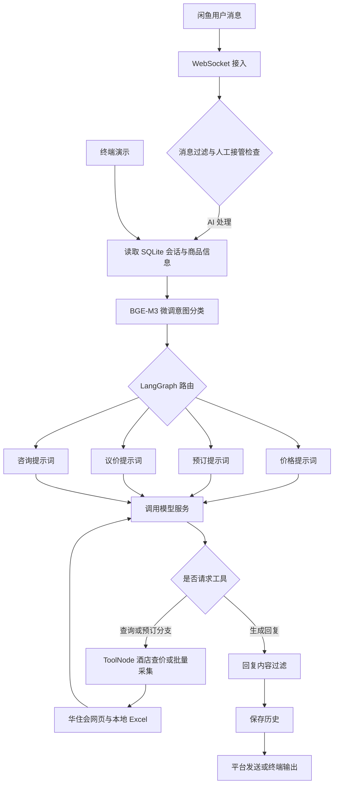

# YF-Agent · 闲鱼酒店场景智能客服

[](https://www.python.org/)
[](https://github.com/langchain-ai/langgraph)
[](LICENSE)

**将闲鱼消息接入、酒店意图识别、多轮对话和实时查价连接起来的 Python Agent 项目。**

YF-Agent 面向酒店咨询与预订沟通场景：通过 WebSocket 接收闲鱼消息，用本地 BGE-M3 微调分类模型识别意图，由 LangGraph 分发到价格、预订、议价或常规咨询节点，按需调用酒店查询工具，再将回复发送回会话。

适合作为 **Agent 工程实践、酒店客服场景原型和课程 / 面试项目展示**。包含平台接入与终端演示两种入口；运行需要自行配置模型服务并准备本地意图模型。仓库不包含完整模型权重，尚未提供真实自动下单、支付或履约接口。

## 导航

- [核心能力](#核心能力)
- [系统架构](#系统架构)
- [项目结构](#项目结构)
- [快速开始](#快速开始)
- [配置说明](#配置说明)
- [演示与项目展示](#演示与项目展示)
- [模型训练与独立模块](#模型训练与独立模块)
- [扩展开发](#扩展开发)
- [常见问题与当前限制](#常见问题与当前限制)
- [许可与致谢](#许可与致谢)

## 核心能力

### 平台接入与人工接管

- WebSocket 消息接收、心跳、Token 刷新与异常重连。
- 按会话 ID 保存历史，同一会话使用异步锁串行处理，减少同时到达的消息造成上下文混乱。
- 人工 / AI 接管切换、接管超时、消息过期与系统消息过滤。
- 可选模拟输入延迟，使用 Loguru 输出运行日志。

### 四类意图与客服流程

- **查询价格**：例如“一晚多少钱？”；进入价格节点，可调用查价工具。
- **下单预订**：例如“周五入住两晚”；进入预订沟通节点，可查询房型和价格。
- **议价砍价**：例如“能便宜一点吗？”；进入议价节点，执行提示词中的业务规则。
- **常规咨询**：例如“交通方便吗？”；进入默认咨询节点。

图中保留 `no_reply` 分支，但当前四分类模型不输出该类别；平台侧另有系统消息过滤。议价策略由提示词决定，当前示例强调价格底线与替代方案，不应宣称已实现自动阶梯降价。

### 工具执行与数据存储

- `search_hotel_price(hotel_name, check_in, check_out)`：匹配 `data/hotels.xlsx` 中的酒店 ID，通过 Playwright 访问华住会详情页获取房型与价格，将结果保存至本地 Excel。
- `crawl_hotels(city, check_in, check_out)`：采集指定城市的酒店数据并写入本地。
- `query_hotel_price.py`：独立逐晚查询与终端汇总，不需要闲鱼 Cookie 或 LLM API。
- SQLite 保存会话、商品信息和议价次数，默认历史上限为 100。
- 独立研究模块提供 BGE-M3 分类训练、Flask 推理 API，以及 FAISS / BGE-M3 / Qwen 预订信息抽取；RAG 模块尚未接入主客服图。

## 系统架构



主流程为 `main.py → xianyu_graph.py`。`XianyuAgent.py` 和 `tools.py` 保留早期 Agent / Function Calling 实现，供对照使用。

图设置循环上限，目前按 LLM 调用轮次计数。模型调用传递 `enable_thinking` / `enable_search` 等通义千问风格扩展参数，切换服务商时需要检查兼容性。

## 项目结构

```text
YF-Agent/
├── main.py                       # 闲鱼在线客服入口
├── xianyu_graph.py               # 图节点、意图路由与工具循环
├── graph_state.py                # 共享状态定义
├── tools_langgraph.py            # LangChain 工具包装
├── context_manager.py            # SQLite 会话管理
├── XianyuApis.py                 # 闲鱼 HTTP 接口
├── XianyuAgent.py                # 早期多 Agent 实现
├── tools.py                      # 早期工具分发器
├── test_chat_graph.py            # LangGraph 多轮终端演示
├── test_chat.py                  # 早期 Agent 演示
├── query_hotel_price.py          # 独立逐晚查价
├── api/intent_api.py             # Flask 意图识别接口原型
├── utils/
│   ├── hotel_tools.py            # 酒店匹配、采集与 Excel 保存
│   └── xianyu_utils.py           # 平台消息辅助函数
├── prompts/*_prompt_example.txt  # 公开提示词模板
├── data/
│   ├── hotels.xlsx               # 酒店名称 / ID 库
│   ├── huazhu_hotels.xlsx        # 酒店采集数据
│   └── hotel_prices.xlsx         # 房价查询结果
├── models/
│   ├── config.py                 # 模型路径、类别与超参数
│   ├── data_preprocessing.py     # 数据清洗与合成训练样本
│   ├── train_model.py            # BGE-M3 分类微调
│   ├── inference.py              # 分类推理
│   └── RAG Entity Extraction/    # 独立检索与实体抽取
├── docs/DEMO.md                  # 展示步骤与讲解提纲
├── .env.example                 # 无真实凭据的配置模板
├── requirements.txt             # 项目依赖
├── Dockerfile                   # 历史部署配置，需适配
└── LICENSE                      # GPL-3.0
```

> 本地外层目录可能名为 `YF-agent`，其内才是 Git 仓库 `YF-Agent`。以下命令均在包含 `main.py` 的仓库根目录执行。

## 快速开始

### 1. 获取代码与安装环境

使用 Python 3.10 或以上版本。磁盘及内存需求取决于本地模型，GPU 可选；CPU 可以推理，实际速度需自行测量。

```powershell
 git clone https://github.com/link080/YF-Agent.git
 cd YF-Agent
 python -m venv .venv
 .\.venv\Scripts\Activate.ps1
 python -m pip install --upgrade pip
 python -m pip install -r requirements.txt
 python -m playwright install chromium
```

Linux / macOS 激活环境使用 `source .venv/bin/activate`。Linux 缺少浏览器系统库时可执行 `python -m playwright install --with-deps chromium`。

### 2. 配置模型服务

```powershell
Copy-Item .env.example .env
```

编辑 `.env`：

```dotenv
API_KEY=your_api_key_here
MODEL_BASE_URL=https://dashscope.aliyuncs.com/compatible-mode/v1
MODEL_NAME=qwen-max
COOKIES_STR=your_cookies_here
```

模型名以服务商账户实际可用的模型为准。终端演示需要前三项，闲鱼接入还需要有效 Cookie。不要提交真实凭据或会话数据库。

### 3. 准备本地意图模型（必要）

**只克隆代码并安装依赖不能直接完成客服对话。** 完整权重未上传；已有历史中只跟踪了部分配置和 tokenizer 文件。

需要准备：

- 基础 BGE-M3 模型，位置由 `models/config.py` 的 `MODEL_NAME` 指定。
- `models/output/train_model/intent_model/` 中的微调 `pytorch_model.bin`、`intent_config.json` 和 tokenizer 文件。
- `intent_config.json` 中的 `model_name` 指向实际基础模型；相对路径以 `models/` 为基准解析。

当前基础模型路径使用特定 snapshot 目录，需按本机实际路径调整。可自行训练，或使用可信来源提供的匹配模型文件。训练步骤见后文。

### 4. 先运行终端演示

```powershell
python test_chat_graph.py
```

脚本使用模拟酒店商品，不连接闲鱼账号。输入消息进行多轮对话，`/quit` 退出。启动时会删除并重建 `data/test_chat_history.db`，不要将真实数据放在该文件中。

### 5. 接入闲鱼

从本人已登录的闲鱼网页开发者工具 Network 请求中获取 Cookie，填入 `.env`。代码使用 `unb` 等字段识别账号，Cookie 不完整或过期会导致连接失败。

```powershell
python main.py
```

使用测试会话发送消息，观察意图、工具与回复日志。入口会交互式补全缺少的 API Key / Cookie，无人值守前应配置完整。

## 配置说明

模板见 [`.env.example`](.env.example)，以下默认值对应当前代码：

- `API_KEY`：模型服务凭据，在线与终端 Agent 必需。
- `MODEL_BASE_URL`：默认 `https://dashscope.aliyuncs.com/compatible-mode/v1`。
- `MODEL_NAME`：默认 `qwen-max`。
- `COOKIES_STR`：闲鱼 Cookie，仅平台接入需要。
- `LOG_LEVEL`：代码默认 `DEBUG`；模板设为 `INFO`，减少调试输出。
- `TOGGLE_KEYWORDS`：默认中文句号 `。`，卖家发送匹配消息时切换当前会话人工 / AI 接管。
- `MANUAL_MODE_TIMEOUT`：默认 `3600` 秒。
- `SIMULATE_HUMAN_TYPING`：默认 `False`，设 `True` 开启模拟输入延迟。
- `HEARTBEAT_INTERVAL` / `HEARTBEAT_TIMEOUT`：默认 `15` / `5` 秒。
- `TOKEN_REFRESH_INTERVAL` / `TOKEN_RETRY_INTERVAL`：默认 `3600` / `300` 秒。
- `MESSAGE_EXPIRE_TIME`：默认 `300000` **毫秒**。

提示词优先读取 `prompts/<名称>.txt`，不存在时读取 `<名称>_example.txt`：

- `price_prompt`：查价与价格回复。
- `booking_prompt`：预订沟通。
- `contect_prompt`：议价规则，保留代码中的现有拼写。
- `default_prompt`：常规咨询。
- `classify_prompt`：早期实现保留，主图使用本地分类模型。

例如复制 `booking_prompt_example.txt` 为 `booking_prompt.txt` 再编辑。正式提示词被 Git 忽略，示例模板可公开。主图有缓存，修改提示词后重启程序。

## 演示与项目展示

完整展示提纲见 [docs/DEMO.md](docs/DEMO.md)。推荐按“业务问题 → 架构 → 对话 → 工具 → 边界”讲解。

建议演示消息：

1. “这家酒店附近交通方便吗？”——展示常规咨询。
2. “全季上海虹桥火车站店，明天入住后天离店，多少钱？”——展示意图、日期参数和查价工具。
3. “想住两晚，需要提供什么信息？”——展示多轮上下文与预订沟通。
4. “能再便宜点吗？”——展示议价规则与业务底线。

这些是输入样例，实际分类与回复取决于模型，价格取决于网页。演示前选用酒店库中确实存在的完整门店名，不将内置模拟商品中的库存和价格当成实时数据。

关注日志中的 `意图识别`、`LLM 请求工具调用`、`[ToolNode] 调用工具` 与 `工具输出`。截图前遮盖真实用户消息、账号标识与凭据。

### 独立逐晚查价

```powershell
python query_hotel_price.py 10 12 全季酒店
```

表示今天起第 10 天入住、第 12 天离店，查询两晚。脚本先执行参数查询，再进入交互模式，输入 `quit` 退出。完整门店名能提高匹配准确性。

输出原始价格、按 **0.75 系数** 计算的演示价格及房型汇总。该系数是脚本固定计算规则，不代表酒店承诺的折扣；“合计”会叠加多个房型，不应当作单笔订单报价。

## 模型训练与独立模块

### 意图分类训练

当前数据预处理从合成酒店语句构建有标签的小样本训练集，ECD 电商文本用于清洗与分析。旧模块 README 中的 HDBSCAN / UMAP 聚类描述不代表当前脚本实际执行逻辑。

1. 准备基础 BGE-M3 模型，调整 `models/config.py` 的 `MODEL_NAME`。
2. 如需 ECD 数据，按 `ECD_DATA_DIR` 准备；原始数据集未上传。
3. 检查 `models/train_model.py` 开头固定的 `D:\config\...` 缓存路径，迁移机器时修改为可写路径。
4. 在仓库根目录执行：

```powershell
python models/data_preprocessing.py
python models/train_model.py
python models/inference.py
```

预处理输出位于 `models/output/data_preprocessing/`，模型输出位于 `models/output/train_model/intent_model/`。依赖包含训练导入所需的 `scikit-learn`。

当前未提供经验证的独立测试集报告；展示时可讲解训练与工程流程，不将代码注释中的时延或旧文档中的加速倍数当成实测指标。

### 意图识别 HTTP API

Flask 是此独立模块的额外依赖：

```powershell
python -m pip install flask
python api/intent_api.py
```

提供 `GET /health`、`POST /predict`、`POST /predict_batch`。

单条请求体：

```json
{"text": "我要订一间大床房"}
```

批量请求体：

```json
{"texts": ["房价多少", "能优惠吗", "有停车场吗"]}
```

API 使用 Windows 相对模型路径，应从仓库根目录运行；Linux 需适配。默认监听 `0.0.0.0:5000` 并开启 debug，属于开发原型；公开部署前需调整监听、调试和访问控制。

### RAG 预订信息抽取

独立目录提供 FAISS 酒店名检索、中文日期解析与 Qwen 辅助抽取，返回酒店名、入住 / 离店日期和置信度。

检查该模块 `config.py` 中的 BGE、Qwen、数据集和索引路径，按需构建索引：

```powershell
Set-Location "models/RAG Entity Extraction"
python build_hotel_index.py
python main.py
```

现有索引不能代替模型权重。此处 `main.py` 是独立演示，与仓库根目录的入口不同；接入主图属于后续扩展工作。

## 扩展开发

- **新增工具**：在 `utils/hotel_tools.py` 实现函数，在 `tools_langgraph.py` 添加 `@tool` 包装并注册到 `_tools`，明确描述与参数。
- **调整策略**：修改提示词；改变分类类别时同步修改训练数据、分类配置和 `route_intent`。
- **更换模型服务**：修改 `.env` 并检查工具调用和 `extra_body` 参数兼容性。
- **接入检索**：将独立 RAG 抽取封装成节点或工具，明确低置信度与日期不完整时的处理。
- **完善部署**：补充领域评测、工具异常兜底、依赖锁定与部署验证。

## 常见问题与当前限制

### 找不到模型文件

检查微调目录的 `intent_config.json`、`pytorch_model.bin` 和基础模型路径。配置存在不意味着权重已就绪；本地微调权重约 2.27 GB，被忽略且未上传。

### 缺包或浏览器

在当前虚拟环境安装 `requirements.txt` 和 Playwright Chromium。训练 / 推理导入 `scikit-learn`；酒店工具导入提供 `Stealth` 类的 `playwright-stealth`。Flask 仅 API 模块需要。

### 查不到酒店或价格

核对 Excel 数据、完整门店名与日期，检查网络及验证页。字符串相似度匹配不能保证同名门店选择正确，应核对返回酒店。网页结构、反爬策略和动态加载变化可能导致失败。

### 模型服务报参数错误

检查当前模型、工具调用、`enable_thinking` 与 `enable_search` 的支持情况。服务商扩展参数可在 `xianyu_graph.py` 的 `_build_llm` 中调整。

### 工具调用达到上限

当前图达到循环上限后可能没有生成最终 `response`，从而触发异常。该边界仍需增加明确兜底回复；展示前试跑工具路径，并准备采集失败时的替代演示。

### `/reset` 是否清空历史？

当前终端脚本只重新创建管理器，数据库记录仍可能保留。完整重置可退出后重新启动，启动过程会删除测试数据库。

### Docker 可以直接使用吗？

当前配置来自较早版本，尚未适配主图：Compose 使用第三方预构建镜像，不构建本地代码；Dockerfile 引用不存在的 `tech_prompt_example.txt`，未复制完整 LangGraph / 模型模块；Alpine 与机器学习及浏览器依赖还需适配。因此推荐本地 Python 环境，Docker 文件作为历史参考。

### 是否能自动完成订房？

预订分支实现信息沟通和工具查询，未接入真实下单、支付和履约。回复过滤是简单关键词规则，正式使用还需验证业务质量。

## 许可与致谢

项目遵循 [GNU GPL v3](LICENSE)，基于既有闲鱼客服代码与酒店业务扩展，使用 LangGraph / LangChain、PyTorch、Transformers、BGE-M3、FAISS、Playwright 和 OpenAI Python SDK 等组件。

模型、第三方数据与平台接口分别遵循各自许可和使用条款。欢迎通过 Issue 提供可复现问题、领域测试样例和改进建议。
