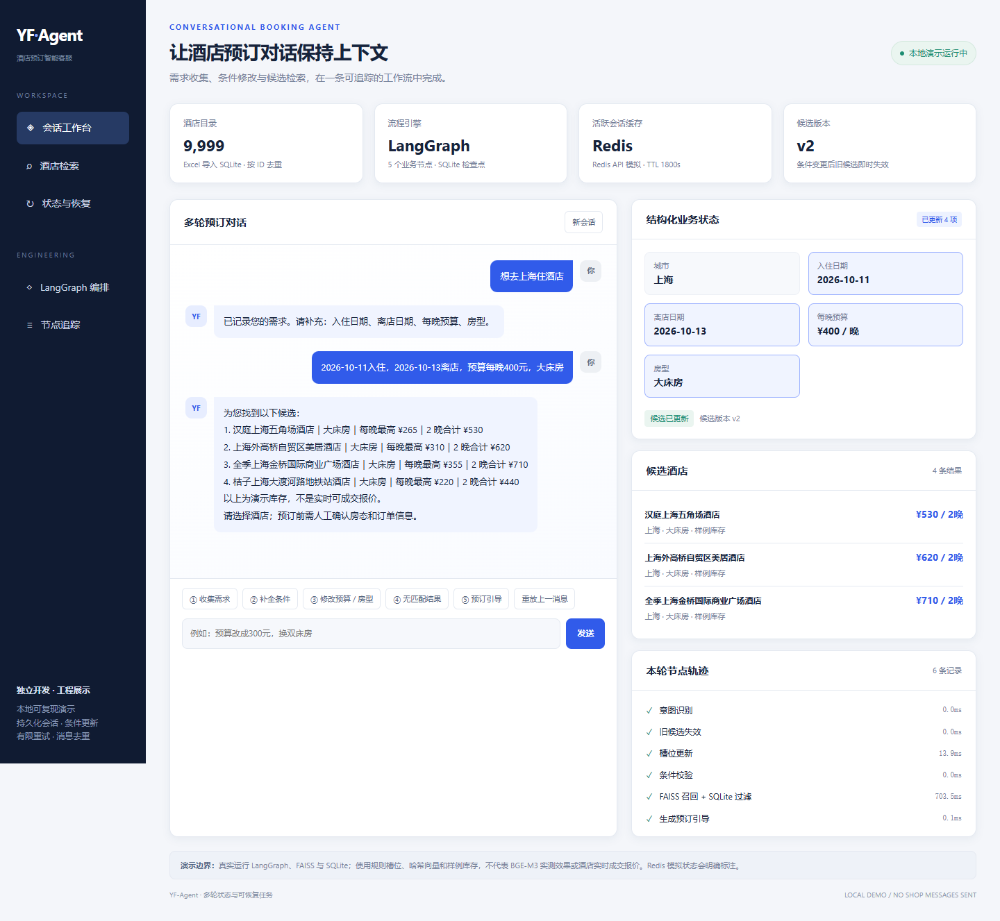
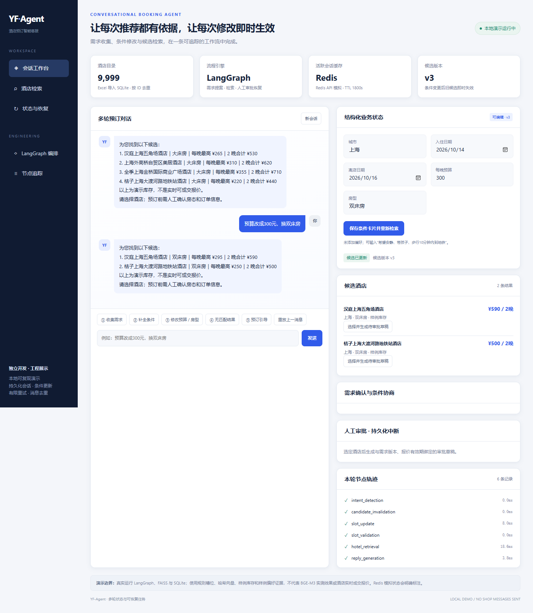
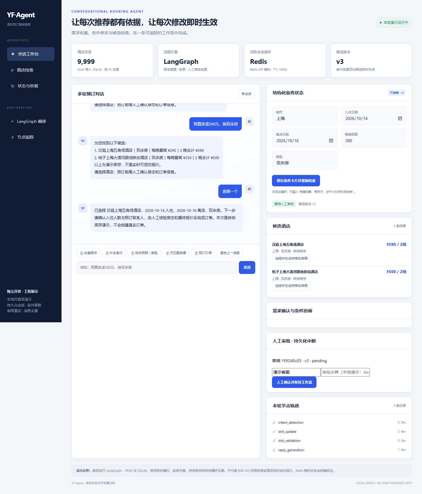
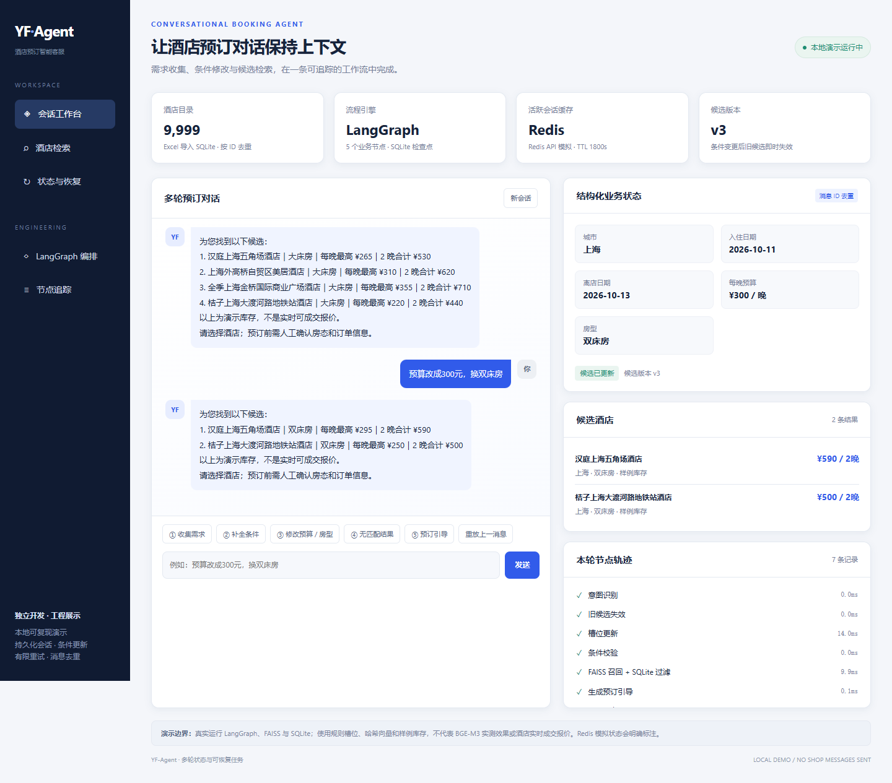
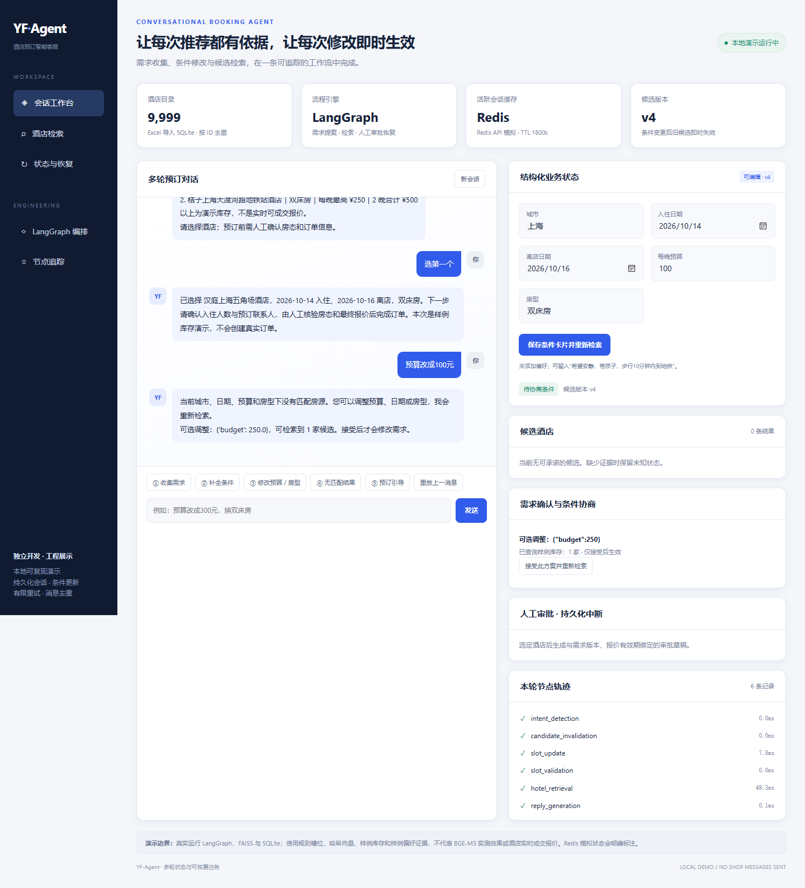
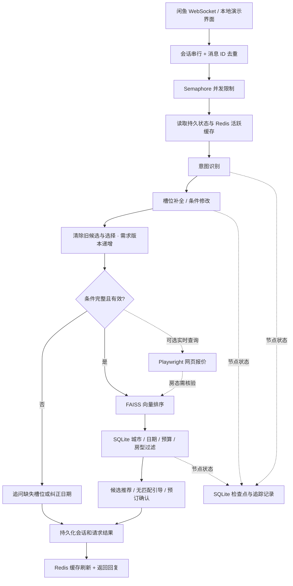

# YF-Agent｜酒店预订智能客服 Agent

[](https://www.python.org/)
[](https://github.com/langchain-ai/langgraph)
[](https://redis.io/)
[](https://github.com/facebookresearch/faiss)
[](https://github.com/spark216/YF-agent/actions/workflows/tests.yml)
[](LICENSE)

**围绕酒店预订咨询，构建可维护多轮状态、可更新检索条件、可追踪与恢复任务的客服 Agent。**

面向酒店代理商的店铺消息场景，串联需求收集、酒店候选推荐、条件修改和预订引导。通过 LangGraph 编排业务流程，Redis 缓存活跃会话，SQLite 保存持久状态、业务数据和检查点，FAISS 对酒店目录进行向量排序。

项目经历：**独立开发，2026.03—2026.05**。当前仓库的会话、恢复及展示功能于 **2026.10** 整理增强。真实店铺接入与用户试用属于开发者项目经历；公开仓库不包含生产账号、用户对话或成交数据。下面的截图和测试结果来自本版本实际运行的离线演示。

<p align="center">
  
</p>

## 项目解决的问题

酒店咨询通常不会一次提供完整条件：“去上海住两晚”“换成双床房”“预算再低一点”。如果只保存聊天记录，Agent 容易继续推荐旧条件下的酒店，或把工具没有返回的房态当成事实。

本项目将近期对话、结构化需求和任务状态分别管理：先补齐城市、入住/离店日期、每晚预算与房型，再查询候选；任何条件变化都会清空旧候选、递增需求版本并重新检索。工具失败保留检查点，同一消息重试时从未完成节点继续执行。

## 工程能力

- **流程编排**：LangGraph 串联意图识别、槽位更新、条件校验、酒店检索、回复与预订引导，真实查价可作为可选节点接入。
- **检索与过滤**：支持 BGE-M3 编码与 FAISS 排序，SQLite 按城市、日期、每晚预算和房型执行约束过滤；酒店目录实际导入 **9,999 家**，约 1 万家。
- **多轮状态**：Redis 保存带 TTL 的活跃会话，SQLite 保存完整业务状态；缓存版本不一致或 Redis 故障时从持久层恢复。
- **候选失效**：城市、日期、预算或房型修改后，立即清除旧候选和已选酒店，使用版本号关联新结果。
- **并发与去重**：同一会话串行处理，不同会话受 Semaphore 限制；按会话 ID + 消息 ID 保存请求结果，重复消息不会追加历史或重复运行工作流。
- **任务恢复**：LangGraph 异步 SQLite 检查点、有限次数重试和工具超时；服务重新启动后可以继续失败的节点，旧任务不会覆盖更新后的需求。
- **追踪与验证**：记录节点状态、耗时、工具结果、重试及异常类型；自动断言覆盖多轮状态和恢复边界，截图通过浏览器实际操作生成。

## 运行效果

### 条件修改：旧候选失效后重新检索

用户从“大床房、400 元/晚”改为“双床房、300 元/晚”，右侧槽位被更新，候选版本递增，酒店结果重新计算。不是将旧结果重新组织成一句回复。

<p align="center"></p>

### 预订引导：选定候选后进入确认状态

用户选择候选酒店后，系统保留当前需求与选择，提示确认入住人数、联系人及最终房态。本项目不自动提交真实订单或执行支付。

<p align="center"></p>

<details>
<summary>展开查看：重复消息去重与无匹配结果</summary>

重放相同消息 ID，工作流记录 `message_dedup`，会话历史不会重复追加。



预算降到 100 元后没有满足条件的样例房源，候选清空并引导修改条件。



</details>

**截图说明：**演示真实执行 LangGraph、FAISS、SQLite 和 Redis 客户端接口；使用规则槽位、384 维哈希向量、样例房态及 fakeredis。它们不代表 BGE-M3 检索效果、真实 Redis 服务部署或酒店实时成交报价，页面也明确标注了演示模式。

## 系统架构



### 状态与存储职责

- **Redis**：近期对话、业务槽位、候选、需求版本和任务状态的活跃缓存，默认 TTL 1,800 秒；不承担最终持久化。
- **SQLite 会话库**：会话状态、消息去重结果、平台回复发送记录、节点轨迹。
- **SQLite 检查点库**：LangGraph 每个节点的可恢复状态。
- **SQLite 酒店库**：酒店目录和逐日房型报价/库存。目录存在不表示指定日期有房。
- **FAISS**：对酒店目录进行向量相似度排序；生产编码器使用 BGE-M3，离线演示使用明确标注的哈希编码器。

当前采用全目录相似度排序后执行硬约束过滤，避免较小 Top-K 提前丢掉满足预算/日期的酒店；约 1 万家目录下使用 `IndexFlatIP`。实现与取舍见 [架构说明](docs/ARCHITECTURE.md)。

## 五分钟运行演示

推荐 Python 3.10—3.12，使用独立虚拟环境。离线模式无需 API Key、闲鱼 Cookie 或模型权重。

```powershell
git clone https://github.com/spark216/YF-agent.git
cd YF-agent
python -m venv .venv
.\.venv\Scripts\Activate.ps1
python -m pip install -r requirements-dev.txt
python demo_web.py --redis-simulated
```

打开 [本地演示页面](http://127.0.0.1:8765)，依次操作：

1. **收集需求**：输入“想去上海住酒店”。
2. **补全条件**：提供入住/离店日期、每晚预算和房型。
3. **修改条件**：输入“预算改成300元，换双床房”。
4. **重复消息**：点击“重放上一消息”，观察去重轨迹。
5. **预订引导**：输入“选第一个”。
6. **无匹配**：将预算改为100元，观察旧候选清空。

终端演示和自动脚本：

```powershell
python demo_booking.py
python demo_booking.py --scripted --output data/demo_runtime/showcase.json
```

样例房态自动存放在隔离的 `data/demo_runtime/` 或 `data/qa_runtime/`，不会覆盖原始 Excel 与生产运行库。展示提纲见 [DEMO.md](docs/DEMO.md)。

## 接入真实 Redis 与模型服务

### Redis

```powershell
docker compose -f docker-compose.redis.yml up -d
Copy-Item .env.example .env
```

设置 `.env`：

```dotenv
REDIS_URL=redis://127.0.0.1:6379/0
SESSION_TTL=1800
MAX_CONCURRENCY=4
TOOL_TIMEOUT=20
TOOL_RETRIES=2
```

`python demo_web.py` 会尝试连接配置的 Redis；使用 `--redis-simulated` 才会启用 fakeredis。Redis 连接失败时保持 SQLite 可用，界面显示回退状态。缓存读取会核对持久层版本，避免旧缓存覆盖新的城市、预算或日期。

### BGE-M3 与模型槽位抽取

```powershell
python -m pip install -r requirements.txt
```

```dotenv
API_KEY=your_api_key
MODEL_BASE_URL=https://dashscope.aliyuncs.com/compatible-mode/v1
MODEL_NAME=your_available_model
RETRIEVAL_BACKEND=bge
BGE_MODEL_PATH=BAAI/bge-m3
LLM_SLOT_EXTRACTION=true
INTENT_BACKEND=rules
LIVE_PRICE_ENABLED=false
```

`BGE_MODEL_PATH` 可设置为本地模型目录。第一次使用模型标识会由模型库下载权重；模型文件不随 Git 提交。可选 `INTENT_BACKEND=bge` 使用已有微调四分类模型，需准备 `models/output/train_model/intent_model/` 与匹配基础模型。

模型槽位抽取只接受已知字段并校验类型、日期；确定性解析优先。默认回复使用可追溯的业务模板，价格与日期来自结构化结果；原有生成式回复图仍保留在 `xianyu_graph.py`，可通过 `demo_chat.py` 对照运行。

### 平台消息与真实查价

配置本人店铺 Cookie 后启动：

```dotenv
COOKIES_STR=your_own_shop_cookies
LIVE_PRICE_ENABLED=true
LIVE_PRICE_HOTELS=2
```

```powershell
python -m playwright install chromium
python run_xianyu.py
```

平台入口已经接入新会话服务。保留心跳、Token 刷新、人工接管和商品信息读取；卖家发送 `TOGGLE_KEYWORDS`（默认 `。`）切换人工/AI 模式。

网页查价只提供参考报价，不能虚构库存数量。真实报价候选进入 `quote_pending`，提示人工核验；只有具备完整逐日房态数据的房源才进入可推荐库存候选。生产库不会自动生成演示房态。

完整配置与部署边界见 [DEPLOYMENT.md](docs/DEPLOYMENT.md)。

## 测试与可复现证据

本地运行：**31 项自动测试通过，6 轮浏览器交互断言通过，生成 5 张真实页面截图**。GitHub Actions 在 Python 3.11 + 真实 Redis 7.4 下 **32 项测试全部通过**，包含缓存过期与持久状态回填。当前仓库的持续集成记录见 [GitHub Actions](https://github.com/spark216/YF-agent/actions)。本机没有真实 Redis 时，该集成项明确跳过。

覆盖需求缺失、城市/日期/预算/房型修改、选择后修改、无匹配、缺少某晚房态、售罄、消息重复、并发上限、Redis TTL/过期/故障/旧缓存、有限重试、工具超时、服务重启恢复和过期任务拒绝。

```powershell
python -m pytest -q
# 启动 demo_web.py 后，使用系统 Edge 捕获真实运行截图
python scripts/capture_demo.py --channel msedge
```

没有 Edge 时可执行 `python -m playwright install chromium`，再使用 `--channel chromium`。测试结果及人工复核检查点见 [TESTING.md](docs/TESTING.md)。

这些工程断言不等同于意图模型准确率、用户转化率或生产吞吐量；真实用户测试记录和模型评测数据未公开。

## 项目结构

```text
YF-Agent/
├── booking_service.py       # LangGraph 预订图、并发、去重、恢复
├── booking_slots.py         # 业务槽位更新与日期/预算校验
├── session_store.py         # Redis 缓存、SQLite 状态与轨迹
├── hotel_repository.py      # SQLite 酒店/逐日报价与 FAISS 排序
├── live_price_provider.py   # 网页报价接入，明确未知房态
├── agent_factory.py         # 演示/真实模型模式组装
├── demo_web.py              # FastAPI 本地展示入口
├── web/index.html           # 会话、槽位、候选与追踪工作台
├── demo_booking.py          # 新业务工作流的终端演示
├── run_xianyu.py            # 闲鱼消息接入与人工接管
├── xianyu_api.py            # 平台 HTTP API
├── context_manager.py      # 兼容已有商品与历史数据库
├── xianyu_graph.py          # 原有生成式客服图
├── langgraph_tools.py       # 原有图的工具注册
├── demo_chat.py             # 原有生成式图终端入口
├── legacy_agents.py         # 早期 Agent 实现
├── utils/hotel_tools.py     # Playwright 酒店查价/采集
├── models/                  # 分类训练、推理与独立预订信息抽取
├── data/hotel_catalog.xlsx  # 9,999 家酒店原始目录
├── images/                  # 实际运行截图
├── tests/                   # 自动化业务与恢复断言
├── scripts/capture_demo.py  # 浏览器交互与截图脚本
├── docs/                    # 架构、部署、测试和展示说明
├── requirements-core.txt   # 轻量工作流与展示依赖
├── requirements-dev.txt    # 测试、Redis 模拟与截图依赖
└── requirements.txt        # 完整模型与采集依赖
```

## 设计边界与后续方向

- 当前会话锁与 Semaphore 面向**单进程服务**；横向扩展需要分布式会话锁、任务租约与共享检查点。
- 消息去重结果持久化，但平台发送与数据库不能组成一个事务。发送记录降低普通重复回复风险，不承诺跨网络故障的严格 exactly-once。
- 超时能够结束等待并留下检查点；线程中的同步工具不会被强制取消，读取型工具必须保持幂等。
- 模型质量和真实酒店网页兼容性需要独立评测；当前截图没有调用真实店铺，也没有使用 BGE-M3 做效果验证。
- 预订引导结束于人工确认，不自动下单或支付。容器默认运行离线工作台；完整模型模式仍需挂载权重和配置，Docker 构建尚未在本机验证。

后续可补充真实领域测试集、低置信度转人工、酒店房态供应商接口、分布式执行与完整订单流程。

## 许可

遵循 [GNU GPL v3](LICENSE)。项目使用 LangGraph、Redis、SQLite、FAISS、BGE-M3、PyTorch、Transformers 和 Playwright 等组件；第三方模型、数据和平台接口遵循各自许可及使用条款。
