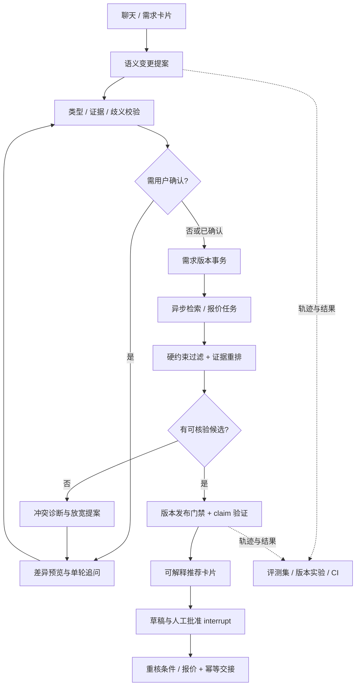

# YF-Agent AI-native 升级设计：需求协商、证据推荐与可控执行

设计日期：2026-10-13。面向 AI 应用 / Agent 工程师与 AI-native Builder / 全栈两类岗位。

**状态：核心 MVP 已实现，2026-10-13。** 需求事务、异步发布门禁、证据约束推荐、条件协商、单问题追问及人工审批已进入代码并验证。具体接口、验证与边界见 [实施说明](AI_NATIVE_IMPLEMENTATION.md)。本文保留长期规划；学习型追问、人工审定模型评测集及模型 A/B 尚未完成。

## 1. 调研结论与证据

这是一组针对性岗位和开源项目样本，不是完整招聘市场统计；不能据此推断岗位比例、统一招聘门槛或薪资趋势。岗位内容与仓库会变化，以下为查询时可访问的描述。

### 牛客：两种不同的岗位侧重点

**AI-native 全栈 / Builder。** 减龄的岗位强调使用 AI 编程工具交付前后端、审查生成代码、处理核心业务与一致性问题，以及部署和独立交付。其代码生成占比属于单个岗位的表述，不作为本项目 KPI。[岗位原文](https://www.nowcoder.com/jobs/detail/459391)

**Agent 应用开发。** 牛客的 Agent 实习岗位强调任务与工具、上下文/记忆、多轮流程，以及评测集、Trace、失败诊断和真实业务迭代。说明可验证的任务质量与工程稳定性是这组样本的重要要求。[岗位原文](https://www.nowcoder.com/jobs/detail/466109)

**更高阶 Agent 系统。** 虾皮校招描述涉及编排、上下文和检索，以及端云任务路由与状态同步。这里借鉴状态和执行边界；不为了匹配该岗位把酒店项目扩大为 Agent OS。[岗位原文](https://www.nowcoder.com/jobs/detail/461356)

后两页直接打开的正文解析受限，以上岗位要点来自搜索返回的招聘正文摘要；没有把不可访问部分补写成已核验要求。

### GitHub：采用成熟机制，不追求框架堆叠

- [LangGraph](https://github.com/langchain-ai/langgraph)：借鉴持久执行、人机协同及状态管理；现有项目继续使用它。
- [Langfuse](https://github.com/langfuse/langfuse)：借鉴追踪、评测集、实验和反馈闭环，可采用轻量本地报告或自托管集成，不强制引入云平台。
- [Mastra](https://github.com/mastra-ai/mastra)：参考应用工程中工作流、工具、记忆和评测的组合；本项目保留 Python，不迁移框架。
- [DeerFlow](https://github.com/bytedance/deer-flow)：参考按需装载能力、执行边界和长任务交互；不复制通用多智能体平台。

岗位归纳与以下酒店设计是针对本项目的推导。上述项目不宣称使用了本文提出的酒店业务策略。

### 双岗位展示策略

Agent 面试展示“模型理解 → 结构化需求 → 工具执行 → 证据验证 → 评测”；Builder 面试展示“用户问题 → 交互原型 → 规格与取舍 → 前后端交付 → 测试与部署”。使用同一个项目与真实证据，不维护两套夸大的能力描述。

## 2. 产品定位与 AI-native 需求

建议定位：**能协商需求、解释取舍并完成预订交接的酒店助手**。项目名称保留“酒店预订智能客服 Agent”，AI-native 描述产品设计方式。

目标用户：买家、酒店代理商客服。目标终点：用户确认需求与候选，形成可供客服核验的预订草稿；不把草稿生成等同于真实下单成功。

新增需求：

1. 理解“带孩子、离地铁近、预算可稍微超一点”等开放表达，区分硬约束、软偏好和需要确认的信息。
2. 自然语言与条件卡片共同编辑一个需求对象，双方看到相同的当前版本。
3. 根据歧义、候选与业务风险决定追问内容，而不是机械收集所有字段。
4. 无匹配时说明冲突，并提出可计算的最小条件调整；未经同意不改变硬约束。
5. 每条推荐说明绑定字段证据、来源和有效期，未知事实保持未知。
6. 用户连续改条件时允许及时更新需求，但后台旧查询不得发布或污染新状态。
7. 选择、报价、人工确认和提交草稿形成可审计的业务动作链。
8. 把失败轨迹转成回归案例，比较提示词或检索策略的改动。

**AI 的必要作用：**开放表达解析、指代/否定理解、追问决策、偏好解释。**代码负责：**约束执行、证据有效性、权限、金额、版本与幂等。用 AI 生成代码本身不能替代这两者的产品作用。

## 3. 现状与缺口

已有：LangGraph、五项基础槽位、Redis/SQLite、FAISS 编码器接口、消息去重、进程内并发、请求检查点、网页参考价、基础追踪和工程断言。

需要增强：

- 槽位目前是普通字典，缺少来源、显式/推断区分、冲突与置信度校准。
- 演示规则无法稳健处理否定、跨轮指代与复杂偏好；模型接口仍需真实轨迹评测。
- 酒店目录主要是名称、城市、品牌，不能证明“安静”“近地铁”“亲子设施”等属性。
- 当前会话锁包住工作流，长工具执行会阻塞后续需求修改；仅有版本号不等于实现实时旧结果防护。
- 无匹配回复没有进行可计算的条件协商。
- 提示“人工确认”尚不是可暂停、可授权恢复的交接动作。
- 现有测试主要证明工程正确性，未衡量复杂语言和推荐效果。

## 4. 关键设计一：需求变更采用事务式提案

### 场景

“不要大床，换双床；日期不变，预算可以到450。”当前条件：上海、两晚、400元、大床。

### 机制

模型生成 `RequirementPatch`，不直接修改会话：操作采用 `set/unset/add_preference/remove_preference/propose_relaxation`，保留用户原句位置、来源与 `base_revision`。

显式明确的变更可立即提交；歧义日期、推断增加预算或放宽硬条件进入待确认提案。模型自报置信度不能单独决定是否提交；还检查类型、证据跨度、日期约束和离线校准结果。

服务执行：解析 → 校验 → 展示差异 → 接受/追问 → 原子提交 → 清空旧候选与选择。用户和卡片都提交同一 API。

```json
{
  "base_revision": 12,
  "operations": [
    {"op": "set", "field": "room_type", "value": "双床房", "origin": "explicit", "evidence": "换双床"},
    {"op": "set", "field": "budget_max", "value": 450, "origin": "explicit", "evidence": "预算可以到450"}
  ],
  "preserve_fields": ["check_in", "check_out"],
  "needs_confirmation": false
}
```

### 独特之处与验收

将自然语言理解产生的不确定性挡在业务状态入口，建立字段来源与变更审计。任何无证据的硬条件扩张不自动生效；“不要大床”不会被关键词覆盖成大床；错误 `base_revision` 返回冲突而不是覆盖。

这是本项目的领域设计取舍，不声称提出了新的事务算法。

## 5. 关键设计二：短状态事务与长工具查询分离

### 场景

查询上海房价还在进行，用户连续说“改北京”“预算300”“双床”。最后一个旧上海结果不能出现在当前推荐中。

### 机制

拆为两条执行通道：

- 状态通道：每会话串行处理短事务，提交变更并立即返回条件版本，不等待浏览器工具。
- 查询通道：后台任务带 `revision + requirement_hash + task_id`，受 Semaphore 限制；可尝试取消旧任务，但正确性不依赖取消成功。

结果发布前，在 SQLite 事务中比较当前 revision/hash。匹配才写入候选并发出事件，否则记录 `stale_result_discarded`。前端同样拒绝低版本事件。Redis 使用持久化后缓存回填，不充当独立业务提交入口。

单进程 MVP 继续使用 SQLite；多 worker 阶段再引入共享数据库与任务租约。租约需要 fencing token 防止过期 worker 写回，不能只用一个带 TTL 的 Redis 锁就宣称强一致。

### 验收

使用可控阻塞工具，让旧任务在新需求提交后完成：旧结果发布数必须为0，旧选择不得恢复，工具失败仍可按对应版本恢复。纯解释问题不无条件废弃仍有用的任务。

## 6. 关键设计三：可计算的约束协商

### 场景

用户指定上海、周末两晚、双床、300元/晚，没有匹配。不能只回复“换日期或加预算”。

### 机制

硬过滤返回结构化 `ConstraintReport`：淘汰原因、有报价的候选、无数据候选、可核验的约束。按一次改变一个允许协商的条件执行诊断查询，例如预算上界、日期浮动、距离偏好。

形成有限个 `RelaxationProposal`：哪些字段改变、增加多少成本、召回多少候选、是否仍满足其他硬条件。采用 Pareto 非支配集避免“价格更高、距离更远还被推荐”。用户接受提案后才提交新需求版本。

房型与入住城市默认不自行放宽。没有报价时只能说“数据不足”，不能推导“加50元就能订到”。预算是每晚还是总价有歧义时先澄清。

### 验收

提案中的增加金额和候选数可由数据库重算；拒绝提案不改变需求；任意新候选仍满足其余硬约束。没有供应商数据的方案标为待核验，不以模拟库存证明效果。

## 7. 关键设计四：证据约束的推荐说明

### 场景

用户要求“带孩子、安静、离地铁近”。BGE 找到一个名字含“地铁”的酒店，但名字不能证明具体距离，也不能证明房间安静。

### 数据与机制

增加 `HotelFact`：字段、值、单位、来源、采集时间、有效期、确认状态。经纬度与地图线路距离单独存储，不能用直线距离冒充步行距离。

属性采用 `known_true / known_false / unknown`，并区分供应商资料、核验记录与用户评价。安静程度属于不确定偏好证据，不因一个评价就形成确定承诺。

硬属性要求若未知，只能返回需核验候选，不标记“满足”。软偏好采用有限规则重排：同等约束下，证据更完整的候选优先；向用户说明证据缺口。

每条推荐输出 `RecommendationClaim`，绑定酒店、字段、证据 ID、报价 ID 与 revision。模型可组织语言，但金额、日期、房型和事实由服务端引用已有字段；无证据 claim 被阻止或降级为“待确认”。

### 验收

删除酒店地铁证据后，回答不能继续声称“步行5分钟”；过期报价不能复用；没有安静证据不生成安静承诺。至少准备少量经核验的酒店资料做效果验证，余下目录保持 unknown。

## 8. 关键设计五：有成本约束的主动追问

### 场景

“明晚住一晚，靠近虹桥，预算400。”可能缺少具体城市/地点指代、房型；不应一次问五个已知信息。

### 机制

维护字段歧义集合和候选分布。优先追问会影响硬可行性的字段，再选择有机会显著区分候选的偏好。初版采用规则评分：业务必要性 + 预估候选区分度 - 用户负担 - 工具成本，不宣称实现严格信息增益最优算法。

每轮最多一个主要问题，可以附带可选快捷项。明确日期歧义必须确认，软偏好允许暂时未知。模型仅在给定字段集合中选择问题并生成措辞，不能发明隐私必填项。

### 验收

已填写字段不反复询问；对未知硬日期不直接查询；记录达到可推荐条件的问询轮数，和“固定顺序问全部字段”基线比较。目标改进需通过实测得出，不预填下降比例。

## 9. 关键设计六：可撤销的确认与交接

### 场景

用户选第一个，酒店报价随后过期；客服确认过程中用户又改日期。旧批准不能用于新日期。

### 机制

区分 `BookingDraft`、`Quote`、`Approval`、`SubmissionReceipt`。批准绑定 `draft_id + revision + quote_id + expiry`。使用 LangGraph interrupt 持久暂停，授权用户/客服提交恢复命令。

恢复前重新检查当前条件与报价有效性。任何变更使旧批准失效。供应商操作使用业务幂等键，保存提交回执；超时后先查询状态再决定重试，不能盲目再次下单。

MVP 只交付草稿和客服摘要。没有供应商写接口时不实现真实提交，也不假造订单回执。人工交接摘要包含已知条件、未知事实、证据、失败原因和下一步。

### 验收

重启后能恢复暂停点；过期报价要求重新确认；非授权主体不能恢复；网络超时时同草稿不产生第二个写请求。写接口尚未接入时该最后一项只能在契约模拟中验证。

## 10. 目标架构与接口



新增模块建议：`requirement_contracts.py`、`requirement_transactions.py`、`retrieval_jobs.py`、`constraint_negotiator.py`、`evidence_store.py`、`clarification_policy.py`、`booking_approval.py`、`evals/`。

保留 `booking_service.py` 做工作流组织，`session_store.py` 负责持久化与缓存，`hotel_repository.py` 执行确定性查询。模型不得拼接任意 SQL 或执行任意 Python；调用类型化工具契约。

接口：

- `POST /requirements/proposals`：从文本生成提案。
- `POST /requirements/commit`：携带 `expected_revision` 提交已确认变更。
- `GET /sessions/{id}/events`：SSE 返回条件与结果事件，携带 revision。
- `POST /relaxations/{id}/accept`：显式接受放宽方案。
- `POST /drafts/{id}/approve`：主体身份、条件版本与报价绑定批准。
- `POST /drafts/{id}/resume`：授权恢复暂停工作流。

优先使用 FastAPI + 当前页面迭代；兼顾 Builder 岗位时可在 P2 迁移为 React/TypeScript 组件化界面，但不是 AI-native 的必备条件。

## 11. 工具、上下文与记忆

工具包含 `search_hotels`、`get_verified_facts`、`query_quote`、`diagnose_constraints`、`create_booking_draft`、`request_human_review`。每个工具声明读/写、输入版本、输出证据、超时与重试策略。MCP 只在确有外部复用需求时加适配层。

给模型的上下文只包含当前需求、近期关键变更、当前版本有效证据和待处理问题。旧候选、过期报价与已否定偏好不重新注入。长期偏好由用户明确选择保存；单次出差预算不自动变成长期记忆。

在固定业务节点之间使用有界决策：追问、检索、协商、交接。第一版不加入多智能体、任意代码执行、自动浏览器下单或自我改写提示词。

## 12. 评测设计与展示证据

已执行：6 类各10条合成确定性业务轨迹，共60条，实际结果见 [报告](evaluation-results.json)。另有并发竞态、重启恢复及幂等工程测试。原计划的人工审定语言评测集与模型版本对比仍待补充，两者不能混为一谈。

基线：现有规则流程；实验A：模型语义补丁；实验B：A + 证据约束；实验C：B + 自适应追问/协商。使用相同案例、供应商快照和预算，保留失败轨迹，不挑选成功展示。

指标：逐字段准确率、硬约束违例率、旧候选发布率、无证据陈述率、任务到达确认草稿的成功率、达到可推荐条件的追问轮数，以及工具耗时、调用次数和 token 使用。完成草稿不计为订单成交。

工程门禁要求：确定性案例中旧结果发布、未批准硬条件放宽、重复写操作为0。语言质量指标先测基线再设上线阈值；模型评分只是辅助，硬约束用代码判定，事实标签人工审定。

Builder 证据另包括：需求规格、ADR 取舍、可运行交互、CI、发布说明、一个 AI 生成错误的定位修复记录。记录实际验证过程，不编写“AI生成90%”或“效率提升十倍”。

## 13. 实施顺序与验收

**P0：语义需求事务 + 双向条件编辑。** 完成类型契约、否定/指代案例、差异确认与 expected_revision 校验。交付自然语言修改和卡片修改得到相同业务状态的演示。

**P1：证据推荐 + 约束协商。** 补充小规模核验资料，明确未知，增加冲突诊断、有限放宽与拒绝/接受流程。交付带证据的推荐和无匹配协商演示。

**P2：异步竞态防护 + 人工审批。** 拆分短事务/长任务，实现条件版本发布门禁和 SSE；草稿审批绑定版本与报价。交付“工具慢返回时用户改条件”和“审批期间需求变化”的演示。

**P3：质量评测与双岗位材料。** 执行版本对比和错误分析，更新真实指标、文档与演示录像。

粗估12—18个独立开发工作日，假设能访问模型且只核验少量酒店资料、不接入真实供应商下单；这是工作量估算，不是承诺。每阶段可独立交付，不必全部完成后再投递。

## 14. 简历写法

当前可写的新能力见 [实施说明的简历表述](AI_NATIVE_IMPLEMENTATION.md#简历可用表述)。未完成的模型对比与学习型追问不作为现有成果。

以下为**对应功能实现并验证后**的候选表述：

- Agent方向：设计带证据来源和版本校验的需求变更协议，处理否定、指代与跨轮条件修改；采用异步结果发布门禁阻止旧报价覆盖新需求。
- Agent方向：构建硬约束过滤、证据约束推荐及有限条件协商，区分未核验事实与确认房态，并通过多轮轨迹对比评估错误来源。
- Builder方向：围绕酒店需求协商实现自然语言与条件卡片的双向编辑、候选解释和人工确认工作台，独立完成接口、交互、自动化验证与部署说明。
- Builder方向：建立规格—实现—回归的 AI 协作开发流程，记录代码审查与错误修复证据，保证模型生成逻辑受到业务约束和 CI 验证。

测得指标后再补“X条轨迹、准确率/违例率、追问轮次变化”等数字。新功能的开发时间按实际发生填写，不反填为早期项目已经完成。
